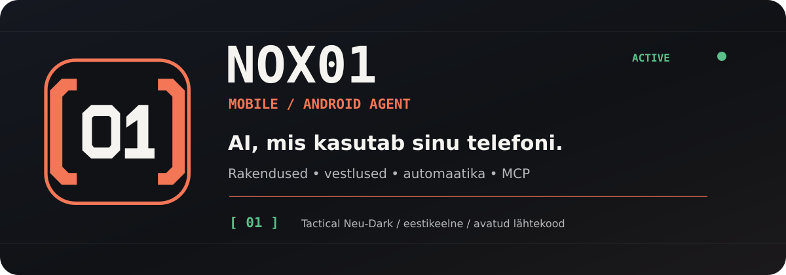
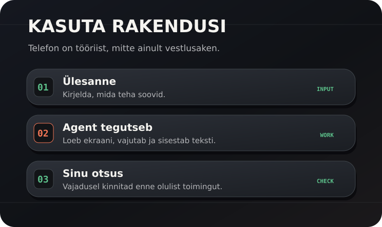
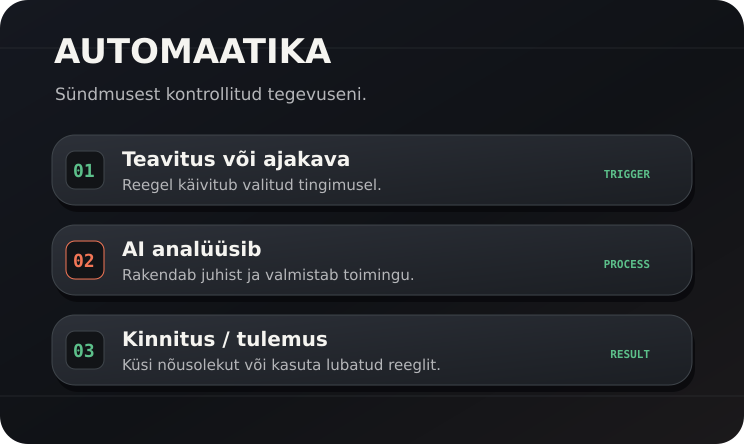
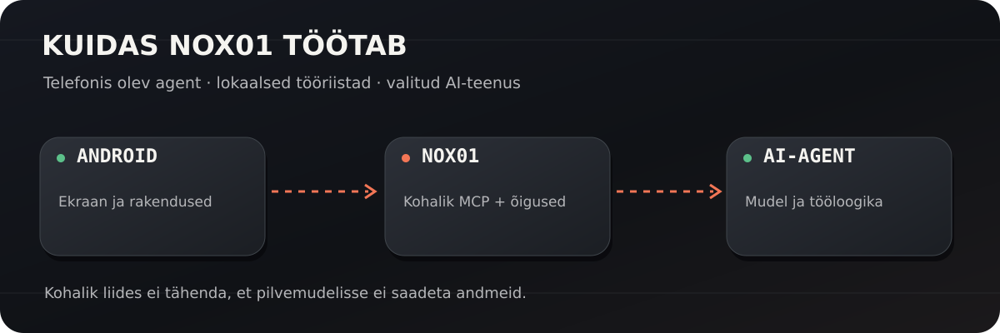

<p align="center">
  
</p>

<p align="center">
  <a href="https://github.com/levomm/nox01-mobile/releases/latest"></a>
  <a href="https://github.com/levomm/nox01-mobile/releases/latest/download/nox01-mobile.apk"></a>
  
  <a href="LICENSE"></a>
</p>

# NOX01 Mobile

**Anna ülesanne. Agent kasutab sinu telefoni rakendusi ja teeb vajalikud sammud.**

NOX01 on Androidi AI-agent, mis ühendab vestluse, telefonis töötavad tehisintellekti tööriistad ja ekraani juhtimise. Agent saab sinu juhendamisel avada rakendusi, lugeda nähtavat sisu, puudutada nuppe, sisestada teksti, kerida ning anda tulemustest ülevaate.

Rakendus pakub **eestikeelset kasutajaliidest**, tumedat **Tactical Neu-Dark** kujundust, valitavaid fonte ja aktsentvärve ning eraldi elavat pikseltegelasega ujuvmulli. Peamise rakenduse tunnus on **[01]**. Mulli tegelane ei ole vestlusakna logo.

<p align="center">
  <a href="https://github.com/levomm/nox01-mobile/releases/latest/download/nox01-mobile.apk"><strong>LAADI ALLA NOX01 APK</strong></a>
  &nbsp;·&nbsp;
  <a href="docs/GUIDE.md">KASUTUSJUHEND</a>
  &nbsp;·&nbsp;
  <a href="docs/PRIVACY.md">PRIVAATSUS</a>
</p>

> **Staatus:** arenduses olev Androidi rakendus. Toimingute võimalused sõltuvad Androidi õigustest, valitud agendist, selle mudelist ja teiste rakenduste piirangutest. Tähtsad tegevused kontrolli alati üle.

## Mida NOX01-ga teha saab?

<table>
  <tr>
    <td width="50%"></td>
    <td width="50%"></td>
  </tr>
  <tr>
    <td><strong>Telefonirakenduste kasutamine</strong><br>Vestlused, veebilehed, otsingud, vormid ja seadete muutmine.</td>
    <td><strong>Automaatika ja ajastamine</strong><br>Teavitusreeglid, korduvad ülesanded ja kontrolli ootavad vastused.</td>
  </tr>
</table>

| Võimalus | Mida see tähendab |
|---|---|
| **Rakenduste juhtimine** | Androidi ekraani lugemine, vajutamine, kirjutamine, kerimine ja rakenduste avamine. |
| **AI-agendid** | Claude Code, Codex, OpenCode, Antigravity ja Grok. Mudeli valik ja sisselogimine sõltuvad teenusest. |
| **Sõnumid** | Agent võib koostada vastuseid ja kasutada näiteks Telegrami või teisi sõnumirakendusi. Saatmine sõltub õigustest ja kinnituse seadistusest. |
| **Teavitusreeglid** | Vali rakendus, saatja või märksõnad ning määra, mida saabunud teavituse korral teha. |
| **Ajastatud ülesanded** | Korduv ülesanne kindlal kellaajal või päeval. Vajalikud kinnitused jäävad kehtima. |
| **Hääl** | Häälkäsklused ja vastuste ettelugemine, kui vastav häälmootor on seadistatud. |
| **Taustal töötamine** | Toetatud seadmetes ja lubadega võib agent kasutada eraldi töövaadet või taustabrauserit. |
| **Mitme agendi töö** | Osa võrdlus- ja otsinguülesandeid saab jagada abistavate agentide vahel. |
| **Linux ja arendus** | Rakenduses olev Alpine Linuxi keskkond võimaldab käskude täitmist, failidega töötamist ja arendustööriistu. |
| **MCP** | Telefonitööriistade kasutamine ka väliste MCP-klientide ning enda arendusvoogude kaudu. |
| **Isiklik mudel** | OpenCode'i kaudu saab ühendada sobiva Ollama, LM Studio või llama.cpp serveri. |
| **Kohandatav välimus** | Tumeda/hele režiimi, värvide, fondi ja ujuvmulli tegelase valik. |

## Näidisülesanded

Need on **näited juhistest**, mitte lubadus, et kõik kolmandate osapoolte rakendused lubavad alati automaatset juhtimist.

```text
ava Telegram ja kirjuta mulle viimase vestluse vastuse mustand.
näita seda enne saatmist.

otsi brauserist kolme toote hinnad ning tee võrdlustabel.

ava telefoni Wi-Fi seaded ja näita, kust saan võrku vahetada.

vaata üle tänased teavitused ja võta oluline kokku.

kontrolli igal hommikul valitud infot ning teavita ainult muutustest.

tee ekraanil oleva vormi täitmise sammud, aga küsi enne kinnitamist.

loo Linuxi tööriistadega väike Androidi utiliit ja näita tulemust.
```

## Kuidas see töötab?

<p align="center"></p>

NOX01 kasutab Androidi juurdepääsetavusteenust ekraani toiminguteks. AI-agent töötab rakenduse enda Linuxi keskkonnas ja kasutab telefoni tööriistu kohaliku MCP-liidese kaudu. Tööriistade teenus on lokaalne ning vajab autentimist. Pilve-AI korral liigub ülesandega seotud teave valitud mudeli teenusepakkujale. See ei ole automaatselt täielikult võrguühenduseta lahendus.

**Turvakontroll:** saatmine, ostmine, kustutamine ja teised tundlikud tegevused on seotud kinnitusreeglitega. Kasutaja võib teatud automaatikareeglitele anda eraldi õigusi. Enne automaatset vastamist või maksetega seotud toiminguid vaata seaded ja õigused üle.

## Paigaldamine Androidis

1. Laadi **[NOX01 viimane APK](https://github.com/levomm/nox01-mobile/releases/latest/download/nox01-mobile.apk)** siit hoidlast. Vajalik on **64-bitine Android 11 või uuem**.
2. Ava APK Androidi paketipaigaldajaga. Anna paigaldusluba ainult usaldatud allikast.
3. Vali rakenduses sobiv AI-agent ja logi vajaduse korral selle teenusesse sisse.
4. Luba ainult vajalikud Androidi õigused. Rakenduste juhtimiseks on tarvis juurdepääsetavusteenust.
5. Proovi esimesena lihtsat ülesannet, näiteks „ava seaded”.

**Uuendamine:** paigalda uus ametlik NOX01 APK olemasoleva peale. Alates püsiva allkirjaga väljalaskest sobib sama allkirjaga uus versioon tavaliselt kohapealseks uuenduseks. **Ära desinstalli rakendust enne andmete varundamist**, sest see võib vestlused ja seadistused kustutada. Teise allkirjaga või teist päritolu APK-d ei saa alati otse üle paigaldada.

APK **ei ole sama asi** mis mujal avaldatud F-Droidi pakett; allkirju ja uuenduskanaleid ei tohi segamini ajada.

## Välimus ja kasutamine

**Tactical Neu-Dark** kasutab tumedaid reljeefseid kaarte, süvistatud aktiivseid juhtelemente ja lühikest elastset vajutusanimatsiooni. Seadetes saad vahetada kujundust, fonti ja aktsentvärvi. DOOM-stiilis pikseltegelase ilmed võivad muutuda vastavalt agendi olekule. Täpne väljanägemine sõltub versioonist ja telefoni ekraanist.

*Päris ekraanipildid lisame pärast konkreetsel Androidi seadmel kontrollimist; selle lehe graafika on teadlikult selgitavad skeemid, mitte väljamõeldud kasutajaliidese kuvatõmmised.*

## Arendajale

```bash
git clone --recurse-submodules https://github.com/levomm/nox01-mobile.git
cd nox01-mobile
./gradlew assembleRelease
```

Täpsemad sõltuvused ja ehitamise juhised: [CONTRIBUTING.md](CONTRIBUTING.md). GitHub Actionsi väljalaske APK ehitatakse ametliku püsiva allkirjastusega. Enda kohalik build võib kasutada teist allkirja ega pruugi olemasolevat NOX01 installi uuendada.

## Privaatsus ja vastutus

- AI kasutab ainult neid telefoni funktsioone, millele on antud vajalikud õigused.
- Ekraanitekst võib sisaldada isikuandmeid; pilvemudeli kasutamisel võib asjakohane sisu jõuda valitud teenusepakkujani.
- Veebilehed, vestlused ja teavitused võivad sisaldada eksitavaid juhiseid. Agentide tegevust peab jälgima.
- Rakenduse juurdepääsetavusteenuse saad Androidi seadetes igal ajal välja lülitada.
- Ära anna agendile paroole, ühekordseid koode ega maksekaardiandmeid.

Loe [privaatsuspõhimõtteid](docs/PRIVACY.md), [turvateavet](SECURITY.md) ja [täpsemat juhendit](docs/GUIDE.md).

## Projekt

**NOX01 Mobile** on avatud lähtekoodiga Androidi projekt, mida arendatakse edasi eraldi identiteedi ja funktsioonidega. Projekti tehniline alus pärineb Hamdi Ghorbeli avatud lähtekoodist; autoriõiguse ja litsentsiteated säilivad vastavalt lähtekoodi litsentsile. NOX01 ei ole Anthropic, OpenAI, Google ega xAI ametlik rakendus.

**Litsents:** [Apache 2.0](LICENSE). Kolmandate osapoolte komponentidel võivad olla eraldi litsentsid. Animeeritud pikseltegelase originaalmängu visuaali kasutusõigusi tuleb hinnata enne avalikku kommertskasutust.

<p align="center"><strong>NOX01 / [01] · Android AI agent</strong></p>
